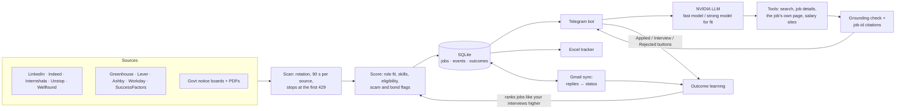

# JobHunter

**An always-on job-hunting agent: it scans 30+ job sources every 2 hours, ranks every posting against one resume,
and answers questions about the jobs on Telegram, citing its sources and never inventing a fact.** Built by Srinivas R C.

- **2,117 jobs per full scan** from 10 sources (LinkedIn, Indeed, Internshala, Unstop, Wellfound, Greenhouse,
  Lever, Ashby, SuccessFactors, career pages) plus 20 Indian government notice boards, under a 10-minute budget.
- **Telegram AI accuracy 40% → 86.7%** on a 30-question eval of real lookups, deadlines, pay, fit and "not in the data"
  questions. Correct citations went from 40% to 70% and the median reply time from 3.2 s to 1.5 s.
- **401 tests**, run in CI on **Python 3.12 and 3.14**, plus code-hygiene guards: no module over 600 lines, no silent
  `except`, and a privacy guard that fails if a personal value reaches a tracked file.



It covers private tech jobs (LinkedIn, Naukri from its alert emails, Indeed, Google Jobs, and companies' own platforms:
Greenhouse, Lever, Ashby, Workday, SmartRecruiters, Workable, Recruitee, Keka, Darwinbox, Zoho Recruit,
SuccessFactors, plus schema.org job data on any careers page) and Indian government jobs (ISRO, NIC, DRDO, BEL,
IISc, C-DAC, banks, KPSC, KEA…), with reservation-aware eligibility checks. The cloud radar runs free on GitHub
Actions; the apply bot runs on the laptop. Claude Code is optional (`/jobhunter` plus the 11
[hunter-skill](https://github.com/Jakeschincariol/hunter-skill) skills).

## Engineering decisions

- **Grounding check, not trust.** Every model-written sentence is checked against what the tools returned: a number,
  date, skill or company that isn't in the sources gets the sentence cut to "not found". The job ids an answer cites
  must be ids the tools returned, and the cards shown are exactly the cited jobs.
- **A human presses Submit.** Forms are filled only from facts in the profile or a saved answer; an unknown field
  stays blank and the form goes to review. A job flagged as a scam is never auto-applied, and any change from chat
  needs a ✅ Confirm tap tied to that exact change.
- **Encrypted cloud state.** The GitHub Actions radar keeps its database AES-256 encrypted on a branch, masks personal
  values in logs, and local secrets and backups stay owner-only (600). Health checks fail if one is ever committed.
- **Rate limits are expected, not errors.** LinkedIn stops at its first 429 for the rest of the run, each source gets
  90 s and keeps what it found, and searches rotate so the next scan picks up where this one stopped. A source that
  returns 0 jobs two scans in a row sends an alert.
- **AI changes are eval-driven.** A fixed 30-question set on real postings is scored for accuracy, citations and
  p50/p95 latency before and after every change. The model choice comes from a benchmark of all live NVIDIA models
  (valid JSON + right tool), not from guessing.

## What I'd do next

- Cut fit-question latency: the strong model now gets 6 s before falling back, but its p95 was 17 s on the eval.
- Fix the remaining citation misses (9 of 30 questions) and re-run the live routing eval after the prompt change.
- Add similarity search on top of keywords: a synonym probe found real gaps ("AI agents" vs "agentic AI",
  "backend engineer" vs "backend developer") that aliases only partly cover.

## Rules it enforces

| Rule | How |
| --- | --- |
| **Location** | Karnataka only (+ remote-India). Everything else is dropped before scoring. |
| **Fresher fit** | Senior/lead/manager titles and posts asking 2+ years are dropped (dream companies kept with a penalty). |
| **Pay floors** | Full-time below **₹6 LPA** dropped (target 8+ ranks higher). Internships below ₹15k/month dropped (₹30k+ ranks higher). Unlisted pay kept. Govt exempt. |
| **Dream companies** | Aditya Birla Group (all businesses) and Birlasoft: +15 score, lower alert bar, front of the apply queue, career pages watched directly. |
| **You check, then submit** | The bot fills the real form, then a JobHunter panel on the page lists every field, its value and its source. You fix anything on the page and press Submit. Nothing is sent before that. (`hunt apply --auto`: no panel, auto-sends only forms where every field is a fact you gave.) |
| **Learns your fixes** | Every value you change on the form (or with ✎ in the Review Center, or `/fix` in Telegram) is saved as your answer and wins over the bot's own choice on every future form. |
| **Everything recorded** | Every attempt is saved field by field, with its source, a screenshot, the resume and the cover letter, in the Review Center and in Telegram (`/form_<id>`). |
| **Asks, never guesses** | An unknown required field becomes a *question* (terminal, Review Center or Telegram). Your answer is saved and reused, and jobs waiting on it re-queue. |
| **It learns** | Answers you type in a paused form go to `data/answers.yaml` and count as facts next time. |
| **No invented facts** | Tailored resumes pass hunter-resume's truth check (`ats.py compare`: no new numbers or skills), and cover letters pass hunter-cover's verifier. Anything that fails is discarded. |
| **Category stays private** | Your reservation category is used only for govt eligibility. It's never typed into a private company's form. |
| **Govt = alert, you apply** | OTR/OTP/fee portals stay manual. You get the link, the eligibility verdict and the last date. |
| **Human pace** | 35–90 s between applications. Caps of 20 LinkedIn and 25 total submits a day. Typing delays. |

> **Risk:** LinkedIn's and Naukri's terms forbid bots. Scanning is logged-out and
> never touches your account. Applying uses your account at a capped, human pace,
> but a restriction is still possible. Lower `max_per_site_per_day` to be safer.

## Privacy (the repo is public)

| file | in git? | holds |
| --- | --- | --- |
| `config/private.yaml` | **no** | name, phone, email, DOB, parents, gender, category, addresses, marks |
| `config/resume.pdf`, `config/advantages.yaml`, `docs/private/` | **no** | your resume, govt advantages, govt strategy |
| `data/` (jobs.db, answers, screenshots, browser profile) | **no** | everything the bot did |
| `config/profile.yaml`, `resume.yaml`, `search.yaml`, … | yes | targets, skills, public resume bullets |

The cloud radar receives `private.yaml` through the `PRIVATE_YAML_B64` secret,
masks every personal value in the logs, and saves its database **AES-256
encrypted** (`STATE_KEY`) on the `radar-state` branch. `tests/test_review.py`
fails if any value from `private.yaml` appears in a tracked file.

On the laptop every `hunt` command keeps `.env`, `private.yaml`, the databases and backups **owner-only
(chmod 600, `data/` 700)**. `hunt health` (and its 30-min alert) checks that none of them is tracked or in
git history and that every backup is encrypted; `tests/test_outcomes.py` fails if this checkout ever
committed one.

## Setup

**Follow [`docs/SETUP.md`](docs/SETUP.md)**: the step-by-step manual (setup, daily and weekly
routine, running without Claude, troubleshooting, disaster recovery). Short version:

```bash
git clone git@github.com:srinivas-rc0408/Hunter.git ~/jobhunter
cp config/private.example.yaml config/private.yaml   # fill it in (you already have yours)
~/jobhunter/scripts/install.sh   # venv, Chromium, `hunt` on PATH (fish too), global skills, systemd units
```

1. **Telegram:** @BotFather → `/newbot` → token into `.env` → message your bot →
   `hunt telegram-id` → id into `.env` → `hunt doctor --test-alert`.
2. **Cloud radar:** `sudo pacman -S github-cli && gh auth login`, then
   `hunt secrets --push`. That generates `STATE_KEY` and sets all the secrets. Then
   `gh workflow run radar -f mode=full`.
3. **Log in once:** `hunt login linkedin`, `hunt login naukri`.
4. **Services:** `./scripts/install-services.sh` sets up the Review Center (http://localhost:8765),
   Telegram bot, morning brief (cloud 07:25, laptop fallback 08:00), cloud sync, laptop scans and weekly encrypted backups.

## Daily use

```bash
hunt list --min 55        # new matches (★ dream, 🏛 govt)
hunt apply --top 10       # tailor + fill + submit basic forms; queue the rest
# open http://localhost:8765 → "To review" → check every field → Approve & Submit
hunt govt; hunt calendar  # govt notices with eligibility + deadlines
hunt advantages           # your reservation / state / GATE advantages checklist
```

`hunt apply --dry-run` fills and records without submitting. You see exactly what
it *would* send in the Review Center.

## Daily use without Claude

Everything runs by itself: cloud radar on GitHub, laptop scans every 2 h, the 07:25 brief (from the cloud; the laptop sends at 08:00 only if it didn't), a health
check every 30 min (an alert arrives on Telegram the first time something breaks, and once when it's
fixed), the Sunday 21:00 weekly report and backup (also deletes form screenshots older than 7 days, keeping sent ones, and compacts jobs.db). From your phone: `today`, `top 5`, `search python`,
`company Zoho`, `govt karnataka`, `eligible`, `deadlines`, `stats`, `outcomes`, `health`, `help`.

**Outcomes:** every job card in Telegram has buttons: ✅ Applied, then 🎤 Interview / ✗ Rejected / 👻 Ghosted,
then 🎉 Offer. After 21 days with no reply the bot asks "ghosted?". `outcomes` shows response and interview
rate by source, role and week (also in the Sunday report). From 20 decided outcomes on, jobs that look like
the ones that got you interviews rank up to 10 points higher, with the reason on the card.

```bash
hunt health                     # every check, ✓/✗ with the exact fix command (same as /health)
hunt apply --top 10             # apply (caps: LinkedIn 20, all sites 25 a day; never the same role twice)

# update to the latest version
git pull && systemctl --user restart jobhunter-bot jobhunter-review

# something broke after an update: go back to the last known-good version
git checkout v1.7-stable && systemctl --user restart jobhunter-bot jobhunter-review
git checkout main               # later, to return to the latest
```

Restore everything (laptop lost): clone the repo, `hunt restore ~/jobhunter-backups/<newest>.tar.gz.enc`
with `STATE_KEY` from your phone notes, then `scripts/install-services.sh`.

## Resume tailoring (hunter-resume inside)

`hunt tailor <id>` (also runs automatically before each apply):
1. writes `hunter/resumes/base.md` from your master resume and `<id>.jd.md` from the posting
2. scores both with hunter-resume's published formula (`50R + 20P + 20B + 10S`)
3. picks the 4 projects that score highest for this JD and puts the JD's skills first
4. with an LLM (NVIDIA build → local Ollama → Gemini → Groq, first that answers), rewords bullets into the JD's own words.
   `ats.py compare` must say **CLEAN** (no invented number or skill), or the rewrite is dropped
5. renders a one-page ATS-safe PDF, and lists what the JD asks that your resume doesn't
   show (add it to `resume.yaml → facts` **only if true**)

## Commands

| command | what it does |
| --- | --- |
| `hunt scan [--light] [--only boards,ats,pages,govt]` | scan, dedupe, score, alert |
| `hunt list / show <id>` | browse a job: full JD, score reasons, keyword gap |
| `hunt apply [ids] [--top N] [--dry-run] [--approve]` | apply in your browser |
| `hunt review` | Review Center (http://localhost:8765) |
| `hunt tailor <id>` / `hunt resume` | tailored resume + ATS report / one-page master PDF |
| `hunt cover <id>` | verified cover letter |
| `hunt govt` / `hunt calendar` / `hunt advantages` | govt radar / dates / your advantages |
| `hunt mark <id> <status>` | applied, interview, offer, rejected, skipped… |
| `hunt answers` / `hunt classify "<label>"` | learned answers / how a label gets answered |
| `hunt sync` / `hunt secrets [--push]` | pull encrypted cloud results / set GitHub secrets |
| `hunt company <name>` | type a company → pick → every listing (date, place, type, source, link) → apply / track / watch / referral links |
| `hunt questions` | answer what forms asked that isn't in your files (asked once, never guessed) |
| `hunt morning [--send]` | morning brief: cloud health, best new jobs, approvals waiting, govt deadlines, GATE countdown |
| `hunt bot` | Telegram bot. **Just type what you want**: *find ML intern jobs in Bengaluru posted this week*, *what does the Birlasoft job need that I don't have?*, *mark ab12cd34 as interview* (any change waits for your **✅ Confirm** tap or a **yes**). Answers about a named job cite its id after each fact, show exactly the cited jobs as cards, re-read the job's own page for deadline / pay / eligibility questions (cached 24 h), and warn first when a job you ask about applying to is flagged as a scam. Fit and comparison questions use NVIDIA's strongest model (nemotron-3-ultra), everything else the fast one. Commands work too: `/top /govt /review /stats /scan /show_<id> /skip_<id> /applied_<id>` |
| Telegram: *add a column Referral* · *put 'text' in Referral for ab12cd34* · *remove ab12cd34 from the sheet* · *show hidden* | your own tracker columns and hidden rows live in the DB and survive every rewrite; Notes and your columns typed into the .xlsx itself are read back on the next refresh (nothing else is) |
| Telegram: *how much would a fresher AI engineer get at Zoho?* | **≈ ₹X–Y LPA (estimate, not from the posting)** from AmbitionBox (company + role, 0–1 yr; the role in your city) and Glassdoor/Levels.fyi/Naukri search results, with links, dates and confidence; internships as a monthly stipend; cached 30 days; cards then say *💰 not listed · ≈ ₹X–Y LPA est.* |
| `scripts/bench_assistant.py` | times every NVIDIA model on the 12 chat examples; the fastest with valid JSON goes in `ASSISTANT_MODEL` |
| `hunt backup` / `hunt restore <file>` / `hunt update` | encrypted backups, restore, self-update |
| `hunt browser [url]` | the bot's browser: on any form press 🎯 Fill this form, check, Submit (recorded + learned) |
| `hunt dream add/remove/list "Name"` | dream companies (+15, watched, pushed to the cloud radar); Telegram `/dream Name` |
| `hunt resume --use FILE` | the PDF every application uploads (or send it to the Telegram bot) |
| `hunt llm [--test] [--models]` | LLM chain status; `--test` checks every key and model |
| `hunt digest` / `hunt dashboard` / `hunt export-hunter` / `hunt doctor` | digest, static HTML, hunter-skill data, health check |

## Tests

```bash
cd tests && python -m unittest discover -v     # scoring, eligibility, fields, dedupe, govt radar,
                                               # real Chromium on Greenhouse/LinkedIn-style forms,
                                               # Review Center + approve flow, tailoring, privacy guard
cd .. && python -m unittest discover -s tests/hunter   # hunter-skill's own suite
```

## Known limits

- **Site layouts change.** The filler reads labels the way a person does, and when a
  flow breaks it queues the form for review instead of guessing. The selectors were
  never run against a real LinkedIn or Naukri login, so do your first runs with `--dry-run`.
- **Cloud IPs get rate-limited** by LinkedIn/Glassdoor sometimes. The laptop scans every 2 h as backup.
  A scan stops LinkedIn at its first 429, gives each source 90 s and rotates searches so the next scan
  picks up where it stopped; `hunt health` shows how many of each source's searches ran in 24 h.
  LinkedIn (6 searches a scan of 95) can't cover all of them daily.
- **A source that returns 0 jobs two scans in a row** (when it usually finds some) sends a Telegram alert:
  its layout probably changed. Company boards are checked one by one on how many postings they list.
- **Scanned (image) govt PDFs** can't be read, so open those yourself.

## Email replies and the Excel tracker
- **`hunt mail`** reads your Gmail (read-only) and sorts every reply to an application: offer, interview,
  assessment, rejected, viewed, received. Each one gets a Gmail label (`JobHunter/Interview` …), is matched
  to the job you applied for, and moves that job's status forward (never backwards). Interview, test and
  offer emails ping Telegram at once. It runs by itself every 30 min with the sync timer.
  A confirmation ("your application was sent to X") marks that job applied on the email's date, and an
  application / reference number in it is saved (never guessed). Response rate counts only real answers
  (viewed, test, interview, rejection, offer); interview rate = (interview + offer) / applied.
  One-time setup: Google Account → Security → 2-Step Verification → **App passwords** → create "JobHunter",
  then put `GMAIL_USER=` and `GMAIL_APP_PASSWORD=` in `.env`.
- **Excel tracker** `~/Documents/JobHunter/Applications.xlsx`, rewritten after every application, status
  change and email check, in place (one file, never a copy). Sheets: **Dashboard** (KPI tiles, applications
  per week, by status, next actions), **Applications** (an Excel Table: dates, IST times, pay or "≈ est.",
  score, status chips, application ID, "Open job" / "Open form" links, days waiting in red after 14 days,
  your own columns, notes), **Email replies**. Prints landscape, one page wide. `hunt sheet --open`,
  `hunt sheet --png DIR` (a PNG of each sheet); Telegram **/sheet** sends you the file, **/mail** lists the replies.
- **🚨 APPLY NOW**: a job scoring 95+ (`alerts.urgent_score` in `config/search.yaml`) gets its own pinned
  Telegram message, is queued first for `hunt apply` when the laptop is on (it still waits for your Submit),
  and reminds you after 2 h and 6 h until you apply or skip (then it unpins). At most 3 a day (`urgent_per_day`).
